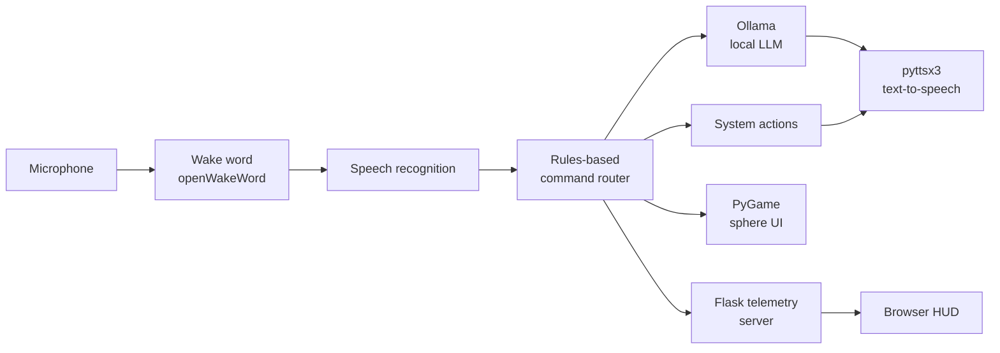

# JARVIS: Local Voice-Activated AI Assistant

A voice-activated AI assistant in Python that runs on your own machine. It combines rules-based command routing, a local language model through Ollama, a PyGame visual interface, and a live browser HUD fed by a Flask telemetry server.

**Status:** v3.2, in active development. See [Known issues](#known-issues) and [Roadmap](#roadmap).

<!-- TODO: add a 60-90 second demo GIF or video link here, e.g.  -->

## Features

- **Voice interaction:** wake-word trigger with openWakeWord and spoken responses with pyttsx3
- **Command routing:** rules-based router that maps spoken commands to actions
- **Local language model:** natural-language handling through the Ollama local API
- **Visual interface:** PyGame sphere UI
- **Live telemetry:** Flask server (`jarvis_server.py`) streams system status to a browser HUD (`jarvis_hud.html`)
- **Runs locally:** the core pipeline uses a local model and offline text-to-speech

## Architecture



> Simplified overview. See the source for exact data flow.

## Tech stack

Python, Ollama, Flask, PyGame, pyttsx3, openWakeWord, HTML/JS (HUD)

## Getting started

**Prerequisites**

- Python 3 (tested on: `<your version>`)
- [Ollama](https://ollama.com) installed, with a model pulled (`ollama pull <model>`)
- A working microphone

**Setup**

```bash
git clone <your-repo-url>
cd <repo-folder>

python -m venv .venv
# Windows: .venv\Scripts\activate
# macOS/Linux: source .venv/bin/activate

pip install -r requirements.txt

cp .env.example .env     # then edit .env with your own values
```

**Run**

```bash
python jarvis_server.py   # telemetry server
python jarvis_local.py    # assistant
# then open jarvis_hud.html in a browser
```

## Project structure

```
jarvis_local.py     # main assistant: wake word, routing, TTS, PyGame UI
jarvis_server.py    # Flask telemetry server
jarvis_hud.html     # browser HUD
.env.example        # configuration template (copy to .env)
requirements.txt    # dependencies
```

## Known issues

- **Wake word reliability:** the openWakeWord "jarvis" trigger does not fire consistently. The confidence-threshold behaviour is under investigation.

## Roadmap

- [ ] Wake-word reliability fix
- [ ] Telegram / Gmail integration
- [ ] Screen vision
- [ ] Boot-on-startup
- [ ] Document creation pipeline
- [ ] Self-diagnostics

## Security

Keep all tokens and credentials in `.env`. Never commit that file.

## Author

**Izzan Ahmad Reksaatmadja**: Electrical Engineering (IUP) student, Institut Teknologi Sepuluh Nopember (ITS), Surabaya.
[LinkedIn](https://www.linkedin.com/in/izzan-ahmad-6aa782342/) · izza0as@gmail.com

## License

MIT, see [LICENSE](LICENSE).

*Inspired by the fictional J.A.R.V.I.S. This project is not affiliated with or endorsed by Marvel or Disney.*
