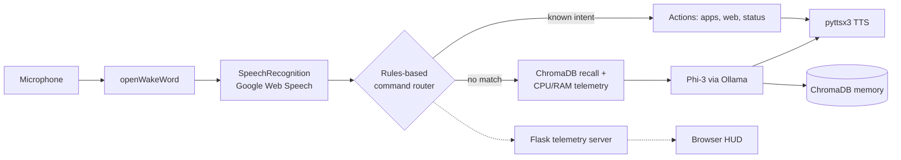

# JARVIS: Local Voice-Activated AI Assistant

A voice-activated AI assistant for Windows, written in Python. A rules-based command router handles known commands instantly, and a local Phi-3 model (via Ollama) with persistent ChromaDB memory handles everything else. It includes a PyGame status interface and a live browser HUD fed by a Flask telemetry server.

**Status:** v3.2, in active development. See [Known issues](#known-issues) and [Roadmap](#roadmap).

<!-- TODO: add a 60-90 second demo GIF or video link here, e.g.  -->

## Features

- **Wake word:** hands-free activation with openWakeWord
- **Voice input:** SpeechRecognition with Google's free Web Speech API (requires internet)
- **Rules-based router:** a fast lane for known intents (system status, opening YouTube, launching apps such as Spotify, Discord, VS Code and Notepad) that bypasses the LLM
- **Local LLM fallback:** anything the router does not recognise goes to Phi-3 through the Ollama API on `localhost:11434`
- **Persistent memory:** ChromaDB stores past exchanges and recalls relevant ones by semantic distance, injecting them into the prompt together with live CPU and RAM telemetry
- **Offline speech output:** pyttsx3 text-to-speech
- **PyGame interface:** a pulsing status sphere with a live telemetry overlay
- **Browser HUD:** `jarvis_hud.html` polls a Flask API (`/api/state`, `/api/logs`, `/api/command`, `/api/ping`) for status, logs and system metrics, and can send text commands back

## Architecture



## Tech stack

Python · Ollama (Phi-3) · ChromaDB · openWakeWord · SpeechRecognition · pyttsx3 · PyGame · Flask · psutil · HTML/CSS/JS

## Getting started

**Prerequisites**

- Windows (app launch paths and TTS voice selection assume Windows)
- Python 3
- [Ollama](https://ollama.com) installed, then `ollama pull phi3`
- A working microphone

**Setup**

```bash
git clone https://github.com/azzian669/JARVIS-A.I-assistant.git
cd JARVIS-A.I-assistant

python -m venv .venv
.venv\Scripts\activate

pip install -r requirements.txt
```

`PyAudio` can be awkward to build on Windows. If `pip install` fails on it, install a prebuilt wheel for your Python version.

**Run**

```bash
python jarvis_local.py
```

`jarvis_local.py` starts the telemetry server itself. Open **http://127.0.0.1:5000** in a browser to view the HUD. You can also run `python jarvis_server.py` on its own to test the HUD without the assistant.

**Optional: private persona**

By default JARVIS uses a short generic persona. To customise it, copy `persona.example.txt` to `persona.txt` and edit it. `persona.txt` is git-ignored, so personal details stay on your machine.

## Project structure

```
jarvis_local.py        # main assistant: wake word, STT, router, LLM, memory, TTS, PyGame UI
jarvis_server.py       # Flask telemetry/HUD API
jarvis_hud.html        # browser HUD
persona.example.txt    # template for a private persona (copy to persona.txt)
requirements.txt       # dependencies
legacy/                # v1 cloud prototype (Gemini + edge-tts), kept for reference
```

## Known issues

- **Wake word reliability:** the openWakeWord "jarvis" trigger does not fire consistently. The confidence-threshold behaviour is under investigation.
- **Not fully offline:** speech-to-text currently goes through Google's Web Speech API. Replacing it with a local engine is on the roadmap.
- **Windows only:** launcher paths and voice selection are Windows-specific.

## Roadmap

- [ ] Wake-word reliability fix
- [ ] Local speech-to-text to make the pipeline fully offline
- [ ] Telegram / Gmail integration
- [ ] Screen vision
- [ ] Boot-on-startup
- [ ] Document creation pipeline
- [ ] Self-diagnostics

## Evolution

`legacy/` holds the first version: a cloud-based prototype using the Gemini API and edge-tts. v3.2 moved the language model, memory and routing on-device. See `legacy/README.md`.

## Security

This project stores no credentials. If you add integrations, keep keys in environment variables or a git-ignored `.env`, never in source.

## Author

**Izzan Ahmad Reksaatmadja**: Electrical Engineering (IUP) student, Institut Teknologi Sepuluh Nopember (ITS), Surabaya.
[LinkedIn](https://www.linkedin.com/in/izzan-ahmad-6aa782342/) · izza0as@gmail.com

## License

MIT, see [LICENSE](LICENSE).

*Inspired by the fictional J.A.R.V.I.S. This project is not affiliated with or endorsed by Marvel or Disney.*
